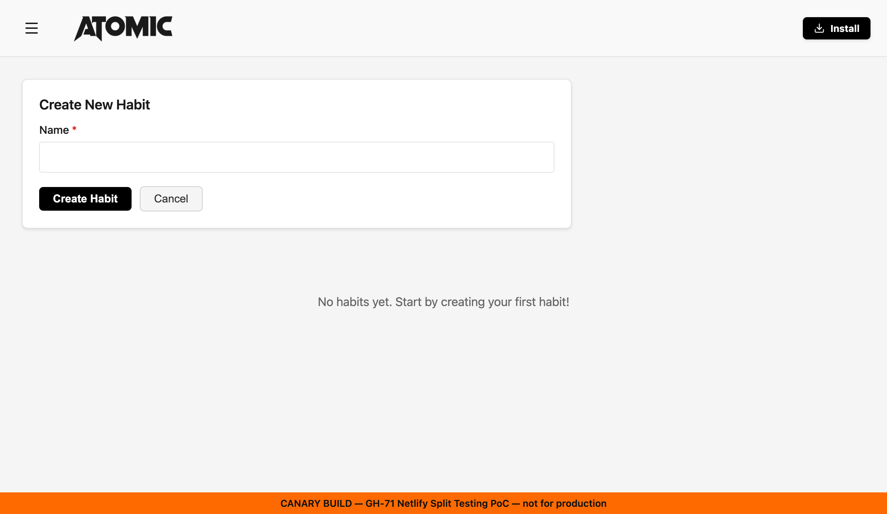

# Canary Deployment Research (GH-71)

Research spike evaluating simple, free canary/gradual-rollout options for habit-tracker, a static React SPA/PWA hosted on Netlify.

## Executive Summary

habit-tracker deploys to Netlify from `main` via Netlify's native GitHub integration (no `netlify.toml` or GitHub Actions deploy workflow exists in this repo — Netlify's own git integration handles builds and production deploys directly). Five approaches were evaluated against the goals of this spike: true percentage-of-traffic canary, lowest complexity, and free/open-source only.

**Recommendation: Netlify Split Testing.** It is Netlify's native, built-in canary mechanism — zero custom code, no `netlify.toml` changes, cookie-based CDN-level traffic splitting, and free on every Netlify plan (including the free tier). It's the closest fit to "true canary" with the least amount of new infrastructure or code to own. A proof of concept confirmed the underlying deploy mechanism works end-to-end (see [Proof of Concept](#proof-of-concept)).

## Approach Comparison

| Approach | True % traffic split | Complexity | Cost | Works with SPA / service worker | Verdict |
|---|---|---|---|---|---|
| **Netlify Split Testing** | Yes (CDN-level, cookie-based) | Low — UI config only, no code | Free (all plans) | Yes, no documented restrictions | **Recommended** |
| GitHub Actions staged rollout | No (staged/gated, not real %) | Low-medium — one workflow + branch deploys | Free (public repo = unlimited Actions minutes; Netlify branch deploys free) | Yes | Alternative — simplest, but not a real canary |
| Custom Netlify Edge Function router | Yes (custom cookie bucketing) | Medium-high — hand-written routing logic to build and maintain | Free (Netlify Edge Functions included in free tier) | Yes, but mutually exclusive with Split Testing | Alternative — more control, more code |
| Flagger / Argo Rollouts | Yes (in Kubernetes) | Very high — requires a Kubernetes cluster + service mesh/weighted ingress | Not free in practice — managed K8s has real infrastructure cost | No — no Kubernetes anywhere in this stack | Rejected |
| Application-level feature flags (hand-rolled or GrowthBook) | N/A — canaries the *feature*, not the *deployment* | Low (hand-rolled) to medium (GrowthBook) | Free (hand-rolled has no dependency; GrowthBook is self-hostable or has a free cloud tier) | Yes | Complementary, different problem |

## Detailed Analysis

### 1. Netlify Split Testing (Recommended)

Netlify Split Testing divides traffic between Git branches directly at the CDN, without any third-party JavaScript or `netlify.toml` configuration:

- Configured entirely in the Netlify UI: **Project configuration → Build & deploy → Continuous deployment → Split Testing**. Pick branches, assign traffic percentages (must total 100%), click "Start test."
- Traffic assignment uses a persistent `nf_ab` cookie (a random value 0-1) so the same visitor always sees the same branch variant. The cookie can also be set manually client-side to a branch name for opt-in-only testing.
- Available on **all Netlify plans**, currently in Beta, not deprecated (verified against current Netlify docs, July 2026).
- No documented restrictions for single-page apps or service workers.

**Prerequisites on this site:** Split Testing requires **branch deploys** to be enabled for the candidate branch(es). This repo's site currently has branch deploys set to "Deploy only the production branch" (confirmed in Netlify's dashboard, Project configuration → Build & deploy → Continuous deployment → Branches and deploy contexts). PR-based Deploy Previews are already enabled and unaffected. Enabling branch deploys is a persistent site-configuration change and was intentionally left for the site owner to apply when actually adopting this approach (see [Proof of Concept](#proof-of-concept) for why this wasn't flipped on during the spike).

**Caveats:**
- Only one split test can run at a time.
- Split Testing and Netlify **Edge Functions are mutually exclusive** — requests to a site with Split Testing enabled will not execute Edge Functions.
- Does not work correctly with serverless functions, SSR/ISR, or scheduled functions (none of which this project uses, so not a blocker here).
- Whatever code differs between the two branches is part of the test — if one branch has functionality the other doesn't, that's a real, visible inconsistency for the users who land on it.

### 2. GitHub Actions staged/gated rollout

GitHub Actions cannot perform runtime traffic splitting on its own — it can only build and trigger deploys. One workable pattern: push a candidate build to a Netlify branch deploy (Netlify already generates one automatically per branch, e.g. `<branch>--<site>.netlify.app`, once branch deploys are enabled), gate promotion to `main` behind a manual approval step (GitHub Environments protection rules), and let Netlify's existing git integration handle the real `main`/production deploy once approved.

This is a **staged, gated rollout**, not a percentage-of-real-traffic canary: one small group (reviewers) checks a preview, then 100% of production traffic gets the new version at once on promotion. It's the cheapest and simplest option in absolute terms (a public repo has unlimited free GitHub Actions minutes, and branch deploys are free on Netlify), but it doesn't reduce blast radius for real users the way an actual canary does.

### 3. Custom Netlify Edge Function router

A Netlify Edge Function can read/set a cookie to bucket each visitor into a percentage, then proxy or rewrite the request to a candidate branch deploy — effectively hand-building what Split Testing already provides natively. Netlify's free tier includes an Edge Functions allowance, so this remains free.

Trade-offs versus Split Testing: full programmatic/API-driven control over the rollout logic and percentage, and it doesn't depend on the UI-only "one test at a time" limitation — but it means writing, testing, and maintaining routing code, and it **cannot coexist with Split Testing on the same site** (Netlify disables Edge Functions entirely when Split Testing is active). Worth revisiting only if a future need for Edge Functions or more granular rollout control arises.

### 4. Flagger / Argo Rollouts (Rejected)

Both are open-source, Kubernetes-native progressive-delivery controllers that require a service mesh (Istio/Linkerd) or a weighted-routing ingress/Gateway API to function. habit-tracker has no Kubernetes cluster, no service mesh, and no ingress — it is a static site served from a CDN. Adopting either tool would mean standing up and paying for a Kubernetes cluster purely to gain a canary capability that Netlify already provides natively for free. Given the explicit free/open-source-first constraint on this spike, this is where it bites hardest: the *software* is free, but the *infrastructure it requires* is not. Rejected as a poor fit on both complexity and cost grounds.

### 5. Application-level feature flags (Complementary)

A different framing: instead of canarying the *deployment* (which version of the app a visitor gets), canary the *feature* (which code paths are active for a given visitor), while shipping the same build to everyone. Options range from a hand-rolled percentage bucket (hash a persisted anonymous ID, stored in `localStorage`, into a 0-100 bucket, no dependency, fully free) to a self-hosted or free-tier OSS tool like GrowthBook (has a React SDK).

This solves a different problem than "roll out a new version to a few users first" — it solves "roll out a new feature to a few users first," independent of deployments. It composes well with this project's existing pattern of gating optional functionality behind a build-time flag (`VITE_ANALYTICS_ENABLED` for Umami analytics, documented in the README), just with runtime percentage targeting instead of an all-or-nothing boolean. Recommended as a complementary technique for future risky feature launches, not a replacement for deployment-level canary.

## Recommendation & Rationale

Adopt **Netlify Split Testing** as the canary mechanism for habit-tracker:

1. It satisfies "true percentage-of-traffic canary" with no new code to write or maintain.
2. It is free at any usage tier this project is realistic to reach.
3. It works natively with the existing SPA/PWA/service-worker setup with no documented compatibility issues.
4. It requires only a one-time dashboard configuration change (enable branch deploys) to adopt — no ongoing infrastructure to run.

The main trade-off accepted: Split Testing forecloses using Netlify Edge Functions on this site, and only one test can run at a time. Neither is a real constraint today — this project uses no Edge Functions and does not need concurrent tests.

## Proof of Concept

**Goal:** confirm the underlying mechanism Split Testing depends on — a Netlify build of a distinctly-marked branch, served on a real, reachable URL — actually works, without turning on a live percentage split against real production traffic during a research spike.

**What was built:** a throwaway branch (`poc/gh-71-split-testing-canary`, based on `main`) with a two-line `index.html` change: the `<title>` prefixed with `[CANARY]`, and a fixed-position banner reading "CANARY BUILD — GH-71 Netlify Split Testing PoC — not for production." `npm run build` was verified locally before pushing.

**How it was verified:** rather than enabling git-based branch deploys (a persistent site-configuration change) or authenticating the Netlify CLI, the branch was pushed and a throwaway pull request was opened against `main` to trigger Netlify's **already-configured, automatic Deploy Preview** build — the same mechanism that already builds a preview for every real PR in this repo (confirmed via existing PRs #185/#186). This required no new site configuration and no credentials. The resulting Deploy Preview (`https://deploy-preview-187--atomichabittracker.netlify.app`) was opened with the Chrome DevTools MCP; both the `[CANARY]` page title and the banner text rendered correctly:

The pull request was closed without merging and the throwaway branch was deleted immediately after capturing this evidence.

**What this does and doesn't prove:** this confirms the build artifact and Netlify's deploy pipeline work correctly for a distinctly-marked branch. It does **not** exercise the real Split Testing `nf_ab` cookie/percentage-routing mechanism, because that only activates once a split test is actually configured and started for the site — which requires branch deploys to be enabled first, and starting a live split (even at a small percentage) is a real, if brief, production-traffic change that only the site owner should trigger deliberately. That step was intentionally left out of this spike's blast radius.

**Manual steps to actually run a live canary (left for the maintainer):**

1. In Netlify: **Project configuration → Build & deploy → Continuous deployment → Branches and deploy contexts → Configure**. Change "Branch deploys" from "Deploy only the production branch" to include the candidate branch (or "All").
2. Push the candidate branch; confirm Netlify builds a branch deploy for it (visible under **Deploys**, or at `<branch>--atomichabittracker.netlify.app`).
3. Go to **Project configuration → Build & deploy → Continuous deployment → Split Testing**. Select `main` and the candidate branch, assign a small percentage to the candidate (e.g. 1-5%), click "Start test."
4. Verify: visiting the site repeatedly (or clearing the `nf_ab` cookie) should occasionally land on the candidate branch's content; the `nf_ab` cookie value determines which branch a given visitor is pinned to.
5. To stop: return to the Split Testing page and end the test, or set the candidate branch's percentage to 0.

## Implementation Roadmap (if adopted)

1. Enable branch deploys for a designated `canary` branch (or convention, e.g. any branch prefixed `canary/`).
2. Document the release process: merge the candidate to the `canary` branch first, start a small-percentage Split Test, monitor (errors, analytics via the existing Umami integration), then promote to `main` and end the test.
3. No application code changes are required to adopt this — it is purely a release-process and Netlify-configuration change.

## References

- [Netlify Split Testing docs](https://docs.netlify.com/manage/monitoring/split-testing/)
- [Netlify Edge Functions overview](https://docs.netlify.com/build/edge-functions/overview/)
- [Netlify Deploy Previews](https://docs.netlify.com/site-deploys/deploy-previews/)
- [Flagger](https://flagger.app/)
- [Argo Rollouts](https://argoproj.github.io/rollouts/)
- Issue #65 (production deployment workflow) — closed as completed without adding a `netlify.toml` or GitHub Actions deploy workflow, confirming this site deploys via Netlify's native GitHub integration rather than a custom pipeline.
